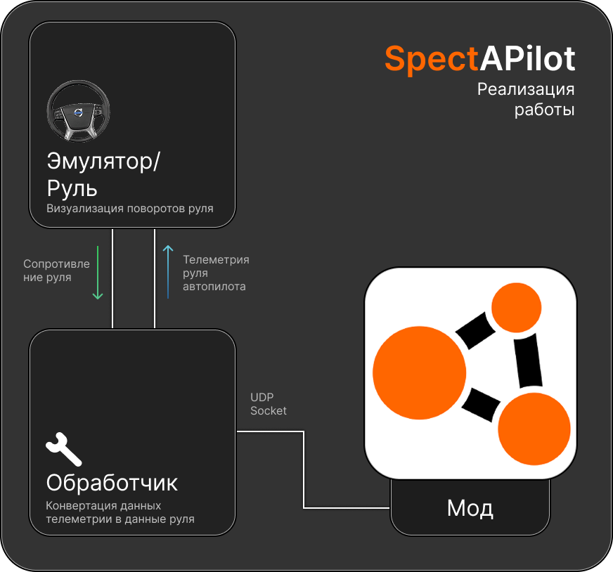

# SpectAPilot (Spectator AutoPilot)

[RU](https://github.com/sophrosha/spectapilot/blob/main/README.md) | [EN](https://github.com/sophrosha/spectapilot/blob/main/README_en.md)

## Что это
Проект реализующий передачу телеметрии руля в настоящий физический руль с поддержкой FFB из Beamng. 

Цель состоит в реализации опыта автопилота не уходя из дома имея всего лишь руль с поддержкой DD/FFB.
## Структура проекта

## Премущества
- Полная визуализация автопилота не выходя из дома
- Возможность кастомизации настроек
- Настройка силы и удержания руля, а так же ограничения угла
- ~~Интеграция с [soulPilot](https://github.com/sophrosha/soulpilot)~~ (позже!)

## Демонстрация работы
https://github.com/user-attachments/assets/1d40f3a7-5d43-46a0-800c-02bea81f6b50
