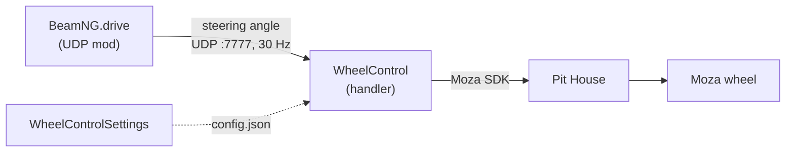

# Документация / Documentation

## О проекте / About the project

**handler** — это набор из двух приложений, которые позволяют управлять настоящим рулём Moza в симуляторе BeamNG.drive: специальный UDP-мод игры передаёт угол поворота руля, а обработчик принимает пакеты и отдаёт их на физический руль через Moza SDK.

*The **handler** project is a pair of applications that drives a real Moza wheel in BeamNG.drive: a dedicated UDP mod in the game streams the steering angle, and the handler receives the packets and forwards them to the physical wheel via the Moza SDK.*

В состав входят `WheelControl` — консольное приложение: UDP-сервер, сглаживание углов и ручной сокет управления; и `WheelControlSettings` — WinForms-приложение: редактор `config.json` со всеми настройками, проверкой Demo и выбором языка интерфейса.

*The project ships two apps: `WheelControl`, the console app with the UDP server, angle smoothing and a manual control socket; and `WheelControlSettings`, the WinForms app that edits `config.json` — all settings, a Demo runner and the UI language picker.*

Каждая страница документации существует в двух языковых ветках — `ru/` и `en/` (зеркальная структура). Архив рабочих заметок `old/` один, на русском.

*Every documentation page exists in two language branches — `ru/` and `en/` (mirror structure). The working-notes archive `old/` is a single Russian one.*

## Оглавление / Table of contents

### Русский / Russian

- [Архитектура](ru/dev/01-architecture.md) — схема, компоненты, потоки данных.
- [Протокол](ru/dev/02-protocol.md) — формат UDP-датаграмм и команд.
- [Конфигурация](ru/dev/03-config.md) — все ключи `config.json`, дефолты из кода.
- [Классы](ru/dev/04-classes.md) — основные классы и их назначение.
- [FAQ](ru/dev/05-faq.md) — типичные проблемы и решения.
- [Лицензирование](ru/dev/06-licensing.md) — MIT, Moza SDK и зависимости.
- [Настройки](ru/user/settings.md) — для конечного пользователя, без кода.

### English

- [Architecture](en/dev/01-architecture.md) — scheme, components, data flows.
- [Protocol](en/dev/02-protocol.md) — UDP datagram format and commands.
- [Configuration](en/dev/03-config.md) — every `config.json` key, defaults from code.
- [Classes](en/dev/04-classes.md) — the core classes and what they do.
- [FAQ](en/dev/05-faq.md) — typical problems and fixes.
- [Licensing](en/dev/06-licensing.md) — MIT, Moza SDK and dependencies.
- [Settings](en/user/settings.md) — for the end user, no code.

Архив / Archive: [old/context.md](old/context.md).

## Схема / Architecture overview

*The game streams the steering angle to the handler over UDP; the handler drives the wheel through the Moza SDK (which requires Pit House to be running), and the Settings app tunes the handler through `config.json`.*

---
[Следующий раздел →](ru/dev/01-architecture.md) | [Next section →](en/dev/01-architecture.md)
