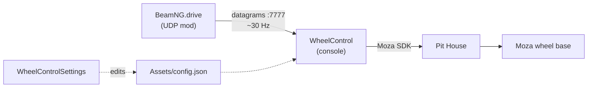

# Architecture

The application takes the steering angle from BeamNG.drive over UDP and forwards it to a physical Moza wheel base via the Moza SDK.

## Components

### WheelControl — console

The only exe that touches the wheel: x64, .NET 8, drives the wheel through the Moza SDK (the `MOZA_API_CSharp.dll` wrapper plus native `MOZA_API_C.dll` / `MOZA_SDK.dll`).

- listens on the UDP port from the config (7777 by default) and parses incoming lines as commands;
- runs a 200 Hz control loop (5 ms tick): the target is smoothed, the "position → velocity → torque" error turns into force on the SDK's ConstantForce effect;
- keeps a log file and supports simulation mode (`--simulate` / `"simulate": true` — the SDK is never touched).

### WheelControlSettings — WinForms

The editor for `Assets/config.json`: every field in one table with tooltips, a "Demo" button (starts the console in demo mode), the language menu and the About dialog.

- the app reads and writes the same file as the console; unknown JSON keys are preserved as-is;
- changes take effect on the next `WheelControl` start; if it is running, the status line will remind you to restart it.

## Data flow

1. The UDP mod in BeamNG sends the angle every ~33 ms (**30 Hz**): one datagram = one value.
2. The handler stores it as a **target**: the queue never grows, every new datagram overwrites the previous one (latest-wins).
3. The **200 Hz** loop smoothly brings the current position to the target (`socketSmoothTimeMs` for the socket, `smoothTimeMs` for the console) and caps the result with the torque and speed limits.
4. The torque then goes to the Moza SDK → Pit House → the base.

## The role of Pit House

The Moza SDK does not work on its own: it boots through **Pit House**, Moza's utility that holds the HID session with the base. While Pit House is not running (or the base is not connected to it), `WheelControl` cannot connect to the wheel. At the same time Pit House is the main source of conflicts: a second app instance or third-party software holding the base will grab the device (see the [FAQ](05-faq.md)).

## Build layout

Next to the exe: `Assets/` (config.json, icons, SVGs), `Libraries/` (the native Moza SDK DLLs), `LICENSE.txt`.

---
[Next section →](02-protocol.md)
