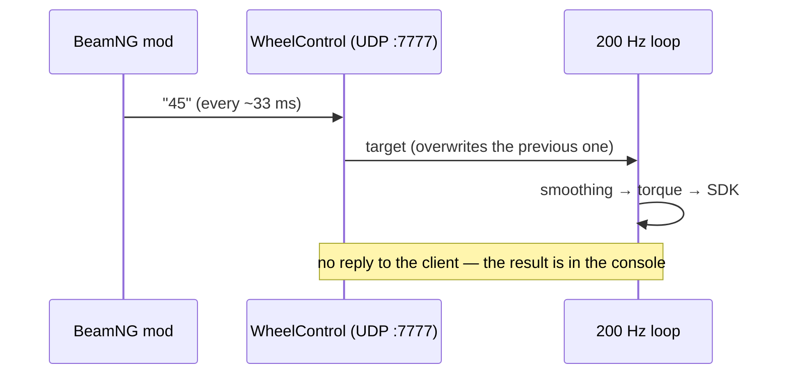

# Protocol

Exchange with the BeamNG mod is text UDP datagrams: one command = one line.

## Transport

- **UDP**, address from the config: `127.0.0.1:7777` by default — localhost only (a security decision).
- **UTF-8 text**; one datagram = one command; a multi-line datagram is split on `\n` and executed line by line.
- **No reply**: the feedback is visible in the `WheelControl` console.
- **~30 Hz** (a datagram every ~33 ms). Processing is instant and the queue never grows: every new datagram simply overwrites the target, and the smoothness comes from the 200 Hz loop.

## Commands

| Command | What it does | Where |
|---|---|---|
| `45` (a number) | absolute angle: wheel target = 45° | console and socket |
| `-45` | on the socket — also a position (the sign = direction); in the console — a relative shift | depends on the channel |
| `+30` | relative turn: target += 30° (everywhere) | console and socket |
| `hold 90` / `hold` | engage hold at the given position (no number — at the current one) | console and socket |
| `release` / `stop` | disengage hold | console and socket |
| `demo [sec] [amplitude°]` | driving simulation in hold mode (50 s by default) | console and socket |
| `status` / `pos` | print the current state | console and socket |
| `socket`, `keyboard` | start/stop the UDP server, return to keyboard mode | console |
| `sleep N` | pause N ms (handy for scripts) | console |
| `log [sec]` | CSV log of the 200 Hz loop for jitter diagnostics | console |
| `help` / `?`, `exit` / `quit` | help, quit | console |

Parsing: case-insensitive, decimals accept `.` or `,` (`90,5` works too). An unrecognized line is treated as an error and printed to the console — it never breaks the channel.

## Scales: game vs physical degrees

- The game sends **its own scale**: full wheel lock = ±`userFullLockDeg` (±**90** by default — "1:1 with the base physics").
- The handler converts game degrees to physical ones: `phys = game × rangeHalf / userFullLockDeg`, where `rangeHalf` is the base's real half-range from Pit House.
- `invertSocket` (`true` by default) flips the sign of an incoming number: if the in-game wheel turns the wrong way — this switch fixes it.
- Target smoothing: from the socket — `socketSmoothTimeMs` (50 ms, almost no delay from the mod), from the console — `smoothTimeMs` (500 ms).

---
[← Back to contents](../../README.md) | [Next section →](03-config.md)
