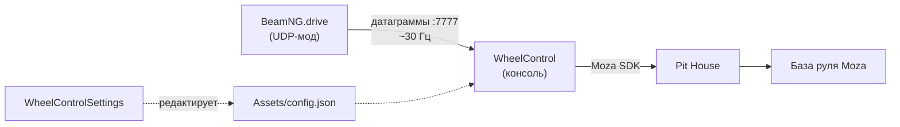

# Архитектура

Приложение принимает угол руля из BeamNG.drive по UDP и передаёт его на физическую базу Moza через Moza SDK.

## Компоненты

### WheelControl — консоль

Единственный exe, который трогает руль: x64, .NET 8, работает с Moza SDK (обёртка `MOZA_API_CSharp.dll` + нативные `MOZA_API_C.dll` / `MOZA_SDK.dll`).

- слушает UDP-порт из конфига (по умолчанию 7777) и разбирает входящие строки как команды;
- ведёт цикл управления 200 Гц (шаг 5 мс): цель сглаживается, ошибка «положение → скорость → момент» превращается в силу на ConstantForce-эффекте SDK;
- ведёт лог-файл, умеет режим симуляции (`--simulate` / `"simulate": true` — SDK не трогается вообще).

### WheelControlSettings — WinForms

Редактор `Assets/config.json`: все поля одной таблицей с подсказками, кнопка «Демо» (запускает консоль в демо-режиме), меню выбора языка, окно «О программе».

- приложение читает и пишет тот же файл, что и консоль; незнакомые ключи в JSON сохраняются как есть;
- изменения применяются при следующем старте `WheelControl`; если он запущен, статус об этом напомнит.

## Поток данных

1. UDP-мод в BeamNG шлёт угол каждые ~33 мс (**30 Гц**): одна датаграмма = одно значение.
2. Обработчик записывает его как **цель**: очередь не растёт, каждая новая датаграмма перезаписывает предыдущую («latest-wins»).
3. Цикл **200 Гц** плавно доводит текущее положение до цели (для сокета — за `socketSmoothTimeMs`, для консоли — за `smoothTimeMs`) и ограничивает результат лимитами момента и скорости.
4. Дальше момент уходит в Moza SDK → Pit House → база.

## Роль Pit House

Moza SDK не работает сам по себе: он поднимается через **Pit House** — утилиту от Moza, которая держит HID-сессию с базой. Пока Pit House не запущен (или база к нему не подключена), `WheelControl` не сможет подключиться к рулю. Одновременно Pit House — и главный источник конфликтов: второй экземпляр приложения или сторонний софт, держащий базу, перехватывает устройство (см. [FAQ](05-faq.md)).

## Структура сборки

Рядом с exe раскладываются: `Assets/` (config.json, иконки, SVG), `Libraries/` (нативные DLL Moza SDK), `LICENSE.txt`.

---
[Следующий раздел →](02-protocol.md)
