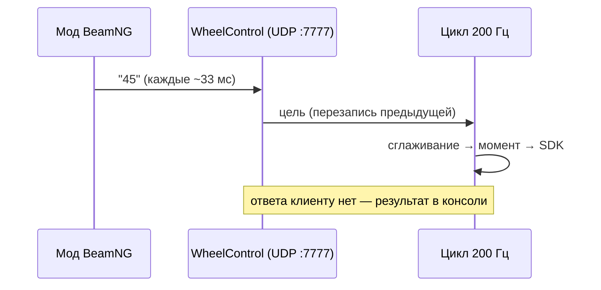

# Протокол

Обмен с модом BeamNG — текстовые UDP-датаграммы: одна команда = одна строка.

## Транспорт

- **UDP**, адрес из конфига: по умолчанию `127.0.0.1:7777` — только localhost (соображения безопасности).
- **UTF-8 текст**; одна датаграмма = одна команда; если в датаграмме несколько строк, они разбиваются по `\n` и выполняются по очереди.
- **Ответа нет**: обратная связь видна в консоли `WheelControl`.
- **~30 Гц** (датаграмма каждые ~33 мс). Обработка мгновенная, очередь не растёт: каждая новая датаграмма просто перезаписывает цель, а плавность добавляет цикл 200 Гц.

## Команды

| Команда | Что делает | Где работает |
|---|---|---|
| `45` (число) | абсолютный угол: цель руля = 45° | консоль и сокет |
| `-45` | в сокет — тоже позиция (знак = направление); в консоли — относительный сдвиг | зависит от канала |
| `+30` | относительный поворот: цель += 30° (везде) | консоль и сокет |
| `hold 90` / `hold` | включить удержание на указанной позиции (без числа — на текущей) | консоль и сокет |
| `release` / `stop` | выключить удержание | консоль и сокет |
| `demo [сек] [амплитуда°]` | имитация езды в режиме удержания (по умолчанию 50 с) | консоль и сокет |
| `status` / `pos` | показать текущее состояние | консоль и сокет |
| `socket`, `keyboard` | запустить/остановить UDP-сервер, вернуться в режим клавиатуры | консоль |
| `sleep N` | пауза N мс (удобно для скриптов) | консоль |
| `log [сек]` | CSV-лог цикла 200 Гц для диагностики дёрганий | консоль |
| `help` / `?`, `exit` / `quit` | справка, выход | консоль |

Разбор: регистр не важен, дробная часть через `.` или `,` (`90,5` тоже работает). Незнакомая строка считается ошибкой и печатается в консоль — канал это не ломает.

## Шкалы: игровые и физические градусы

- Игра шлёт **свою шкалу**: полный ход руля = ±`userFullLockDeg` (по умолчанию **±90** — «1:1 с физикой базы»).
- Обработчик переводит игровые градусы в физические: `phys = game × rangeHalf / userFullLockDeg`, где `rangeHalf` — реальный полудиапазон базы из Pit House.
- `invertSocket` (`true` по умолчанию) меняет знак приходящего числа: если в игре руль крутится в обратную сторону — тумблер решает.
- Сглаживание целей: из сокета — `socketSmoothTimeMs` (50 мс, почти без задержки от мода), из консоли — `smoothTimeMs` (500 мс).

---
[← Назад к оглавлению](../../README.md) | [Следующий раздел →](03-config.md)
